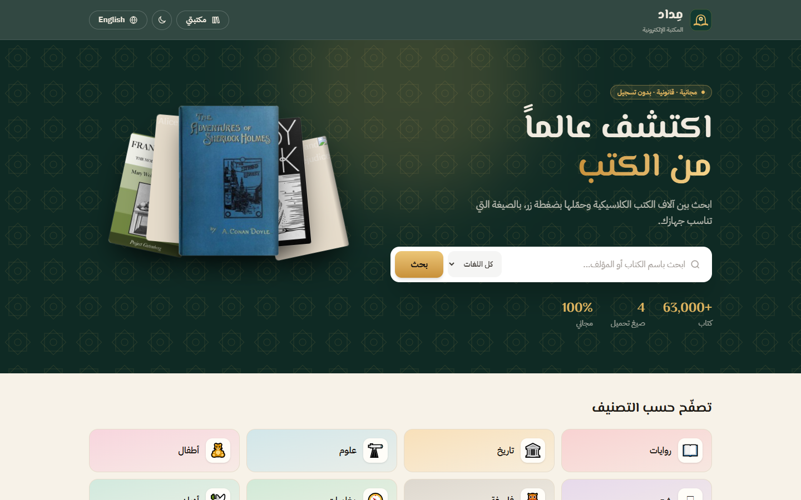
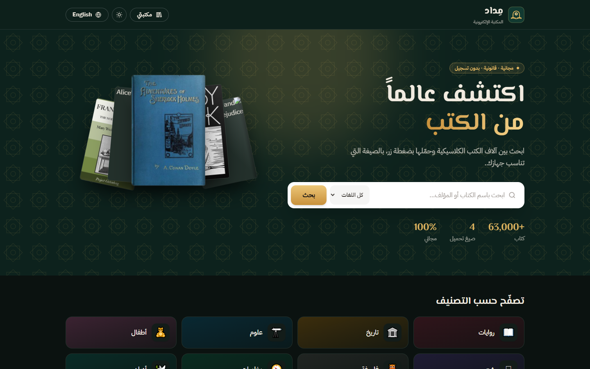
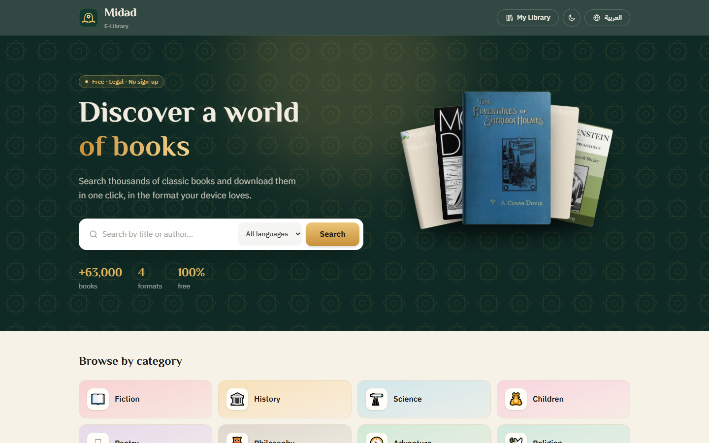
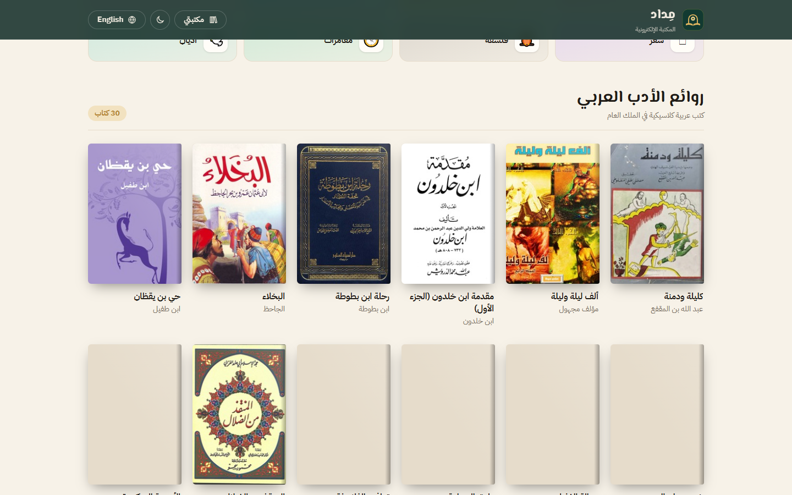
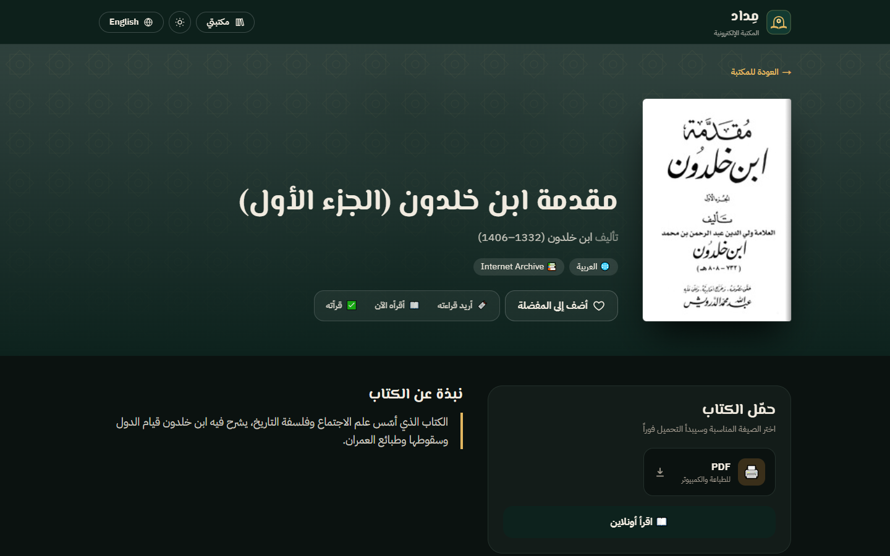
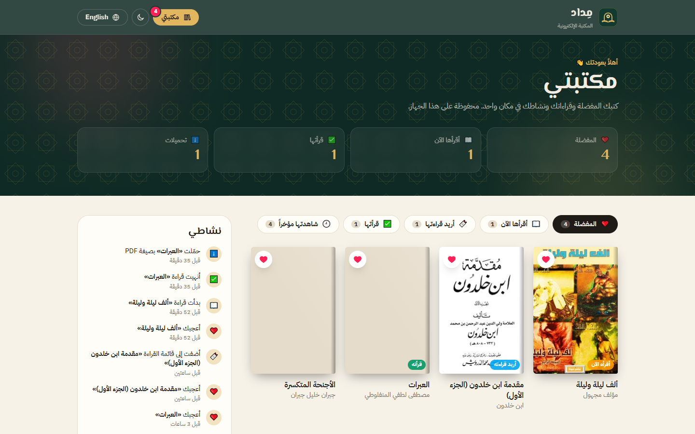
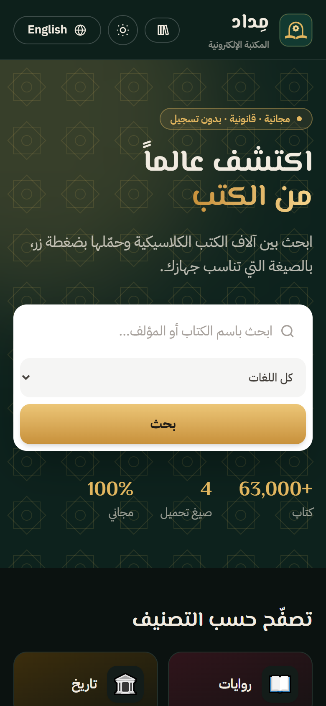
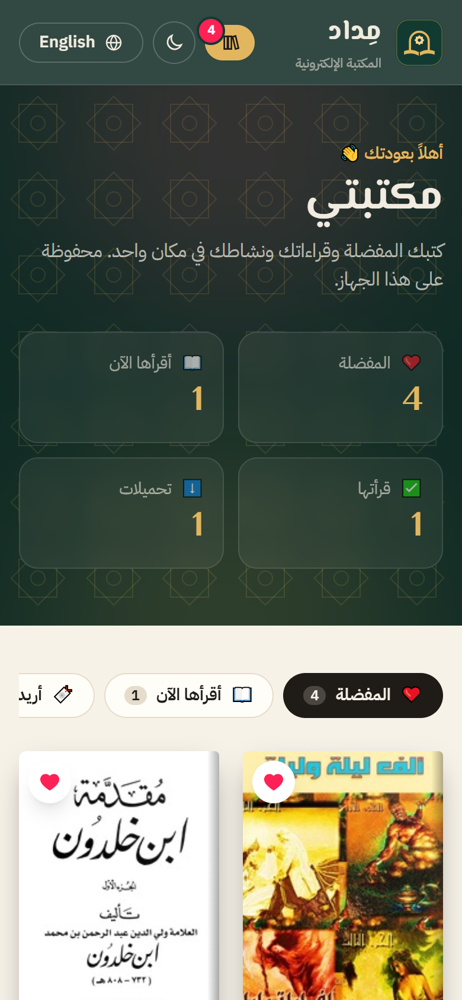

<div align="center">


# Midad · مِداد — Bilingual E-Library

**Discover a world of books. Download them in one click.**

A free, bilingual (Arabic / English) e-library: search 60,000+ public-domain books, browse a hand-picked shelf of Arabic classics, download ready-to-read files, and keep your own reading list — no sign-up needed.


</div>

---

## ✨ Highlights

- **60,000+ free books** — live search over Project Gutenberg by title or author, with categories and paging.
- **Arabic classics shelf** — 30 hand-picked public-domain works (Ibn Khaldun, al-Mutanabbi, Gibran, al-Manfaluti, Shawqi, Jurji Zaydan…), each verified to download.
- **Smart Arabic search** — ignores hamza, diacritics and ة/ه, ى/ي differences, so `الف ليله` finds «ألف ليلة وليلة».
- **Ready-to-read downloads** — EPUB, Kindle, PDF and TXT where available, plus "read online".
- **My Library** — favorites ❤️, reading status (want to read / reading / finished), download history and an activity timeline, saved in the browser.
- **Arabic & English (RTL)** and **Light / Dark mode** that remembers your choice.
- **Static site** — builds to plain HTML/CSS/JS, so it runs on any host, including free PHP hosting like InfinityFree.

## 📸 Screenshots

| Arabic · Light | Arabic · Dark | English |
|---|---|---|
|  |  |  |

| Arabic classics | Book page | My Library |
|---|---|---|
|  |  |  |

| Mobile · Dark | Mobile · My Library |
|---|---|
|  |  |

## 🏗️ Architecture

```
                ┌────────────────────────────────────┐
Browser ───────▶│  Static site (HTML / CSS / JS)      │
                │  /ar/  /en/  · book · my library    │
                └──────┬──────────────┬──────────────┘
                       │              │
        search & books │              │ favorites, reading status,
          (fetch, CORS)│              │ activity  →  localStorage
                       ▼              ▼
     ┌──────────────────────┐   ┌──────────────────────────────┐
     │ Gutendex API          │   │ Curated Arabic catalog         │
     │ (Project Gutenberg)   │   │ src/data/arabic-books.ts       │
     └──────────────────────┘   │ files & covers → Internet Archive│
                                └──────────────────────────────┘
```

## 🧰 Tech stack

| Layer | Technology |
|---|---|
| Framework | Next.js 15 (App Router, static export), React 19, TypeScript |
| Styling | Tailwind CSS 4, El Messiri + IBM Plex Sans Arabic fonts |
| Data | Gutendex API (Project Gutenberg), Internet Archive |
| Storage | Browser localStorage (no accounts, no database) |
| Hosting | Any static host — InfinityFree, Vercel, Netlify, GitHub Pages |

## 📁 Project structure

```
ebook-library/
├── src/
│   ├── app/
│   │   ├── [lang]/            # Pages for each language (ar / en)
│   │   │   ├── page.tsx       # Home: hero, search, categories, results
│   │   │   ├── book/          # Book page (reads ?id=)
│   │   │   └── me/            # My Library
│   │   └── icon.svg           # Logo / favicon
│   ├── components/            # BookCard, Browse, BookView, MyLibrary, LikeButton…
│   ├── data/arabic-books.ts   # Curated Arabic classics
│   ├── i18n/                  # Arabic / English dictionaries
│   └── lib/                   # Gutendex client, library model, user library store
├── public/                    # Root redirect, .htaccess for Apache hosts
└── docs/screenshots/          # Images used in this README
```

## 🚀 Run locally

```bash
npm install
npm run dev
```

Open http://localhost:3000/ar/

### Build & deploy (static)

```bash
npm run build
```

The site is written to `out/`. Upload the **contents** of `out/` to your host's web root (for InfinityFree: `htdocs/`). The included `.htaccess` handles the 404 page and caching.

### Adding an Arabic book

Add an entry to `ARABIC_BOOKS` in `src/data/arabic-books.ts` with the Internet Archive item id (`archiveId`) and the exact file name inside it. Only add works whose authors died more than 70 years ago.

## 🇵🇸 بالعربي

**مِداد** مكتبة إلكترونية مجانية بالعربي والإنجليزي.

- بحث بين أكثر من **60 ألف كتاب** من مشروع غوتنبرغ، حسب العنوان أو المؤلف أو التصنيف.
- رف **«روائع الأدب العربي»**: 30 كتاباً كلاسيكياً في الملك العام، منها مقدمة ابن خلدون، وديوان المتنبي، وجبران، والمنفلوطي، وشوقي، وجرجي زيدان.
- بحث عربي ذكي يتجاهل الهمزات والتشكيل.
- تحميل الكتب بصيغة EPUB و Kindle و PDF و TXT.
- **مكتبتي**: المفضلة، وحالة القراءة، وسجل التحميلات والنشاط، محفوظة على جهازك بدون تسجيل.
- **الوضع الفاتح والداكن** ويعمل على الكمبيوتر والموبايل.

كل الكتب في **الملك العام** ومتاحة قانونياً.

## 📚 Book sources

- [Project Gutenberg](https://www.gutenberg.org) via [Gutendex](https://gutendex.com)
- [Internet Archive](https://archive.org) for the curated Arabic shelf. Archive license tags are self-reported and often wrong, so Arabic books are added by hand after checking the author's dates.

## 👩‍💻 Author

**Basmalah Qaseem** ([@basmalah-Tarq](https://github.com/basmalah-Tarq))

## 📄 License

Released under the [MIT License](LICENSE).
